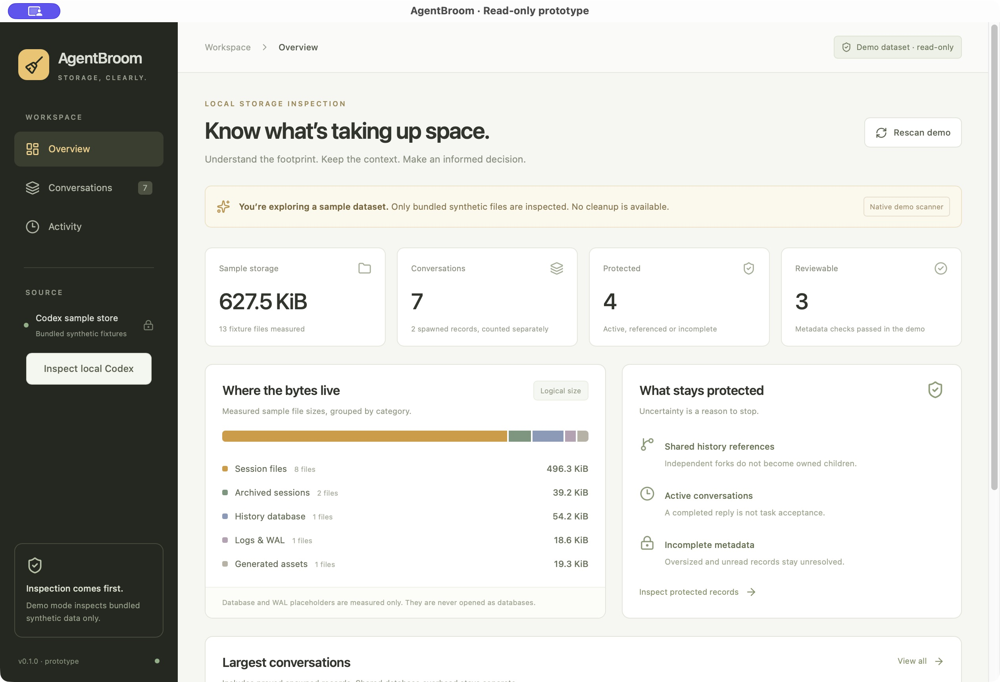

# AgentBroom

**Codex local storage, clearly.**

[简体中文](README.zh-CN.md)

AgentBroom is an early, local-first desktop inspection prototype for coding-agent storage. It makes physical files, logical conversations, spawned agents and independent forks easier to distinguish before anyone considers cleanup.

> **Read-only desktop prototype.** Starts in synthetic demo mode. In the native app, choose **Inspect local Codex** to measure your configured `CODEX_HOME` (or `$HOME/.codex`) and inspect bounded metadata. No database connection, agent CLI, deletion or source write is available. Real records are always protected.



Screenshot: native macOS app, synthetic sample data only.

## Prototype features

- Native Codex storage overview with file lengths and allocated blocks, plus a separate synthetic demo.
- Logical conversations grouped across physical segments; parent, spawned agent, fork lineage and shared-history evidence stay distinct.
- Explicit protection reasons for pins, references, missing parents, conflicts, unsupported headers and unknown runtime activity.
- Search, filters, details and session-local keep choices.
- Demo-only selection previews and JSON reports. Real metadata stays in the app window; no real report export.
- Tauri desktop and an internal CLI sharing one Rust core.

Database reclamation, deletion, compression and recovery are **not implemented**. See the [roadmap](docs/roadmap.md) for the gates those capabilities would need.

## Development

Requires Node.js 24+, a stable Rust toolchain and the platform prerequisites for [Tauri 2](https://v2.tauri.app/start/prerequisites/). The initial native target is macOS Apple silicon.

```sh
npm install
cargo test -p agentbroom-core -p agentbroom-cli
npm run demo:generate
npm run dev              # browser fixture preview
npm run desktop:dev      # native Tauri app
```

```sh
npm test
npm run build
npm run desktop:build
cargo run -p agentbroom-cli -- codex-summary # real aggregate counts/sizes only
```

The browser preview uses a fixture catalog generated by the Rust CLI. Native scanning and browser UI tests are reported separately; a mocked browser preview is not proof of native scanning.

Choose either the browser or native development command; stop the browser development server before starting native development, as both use port 1420.

## Design

- [Codex read-only adapter design and limits](docs/codex-readonly-design.md)
- [Original demo detailed design and IPC boundaries](docs/detail-design.md)
- [Verification plan](docs/test-plan.md)
- [Observed verification](docs/verification.md)
- [Roadmap](docs/roadmap.md)

## Contributing

Read [CONTRIBUTING.md](CONTRIBUTING.md). Please use synthetic data, keep read-only boundaries intact, and avoid uploading real transcripts, paths, screenshots or credentials. This prototype does not accept real agent data as a debugging fixture.

## Security and privacy

No account, telemetry, network service or LLM call in the application. The native Codex adapter reads only bounded session headers, title-index rows and desktop pinned IDs. Auth/config/database/asset contents are never opened. Session headers may contain instructions; unused fields are discarded, and conversation bodies are not parsed. No source file write, SQLite connection, maintenance operation or subprocess exists. Symlinks are never followed. macOS/Linux native inspection only; other platforms retain demo mode. Report vulnerabilities using the repository's private reporting channel when enabled; otherwise contact the maintainer through GitHub before sharing sensitive reproduction material. See [SECURITY.md](SECURITY.md).

## License

MIT. Third-party dependencies retain their own licenses. This project is independent of OpenAI, Anthropic and other agent vendors.
