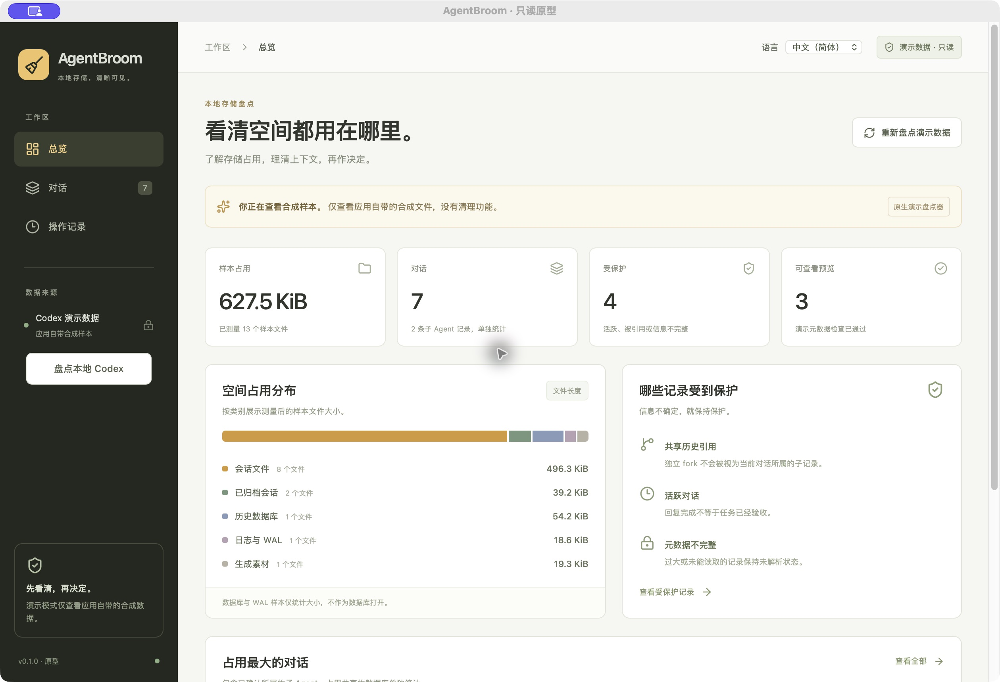

# AgentBroom

Codex 本地存储，清晰可见。

**当前是只读桌面原型，默认进入合成样本模式。原生桌面点击「Inspect local Codex」可盘点真实 `CODEX_HOME`（未设置则使用 `$HOME/.codex`），不会写入或删除任何源文件，不建立 SQLite 连接，也没有数据库回收或恢复功能。所有真实记录都保持受保护。**



已实现：真实文件长度与分配块统计、逻辑对话与物理分段归并、主对话/子 Agent/独立 fork 的关联证据、共享历史引用、置顶与未知状态等保护原因、搜索筛选和分批列表。保留选择只存在内存中；选择预览与 JSON 报告仅对合成样本提供。真实元数据仅在应用窗口查看，不导出。原生桌面与内部 CLI 共用 Rust 核心；网页预览使用该核心生成的样本目录。

支持简体中文与英语，右上角「语言 / Language」可即时切换，并保存本应用的语言偏好。首次启动跟随系统的受支持语言，无法匹配时使用英语。页面、弹窗和保护原因均已翻译；对话标题、路径、ID 与 JSON 报告保持原样。

技术栈为 Tauri 2、Rust、React/TypeScript 与 Vite。首个原生目标是 macOS Apple silicon。

开发需要 Node 24+、稳定 Rust 和 Tauri 的平台依赖。安装 Node 依赖后运行核心测试，生成样本目录，再选择网页或原生开发入口：

```sh
npm install
cargo test -p agentbroom-core -p agentbroom-cli
npm run demo:generate
npm run dev
# 或停止上述服务后运行：
npm run desktop:dev
```

[详细设计](docs/detail-design.md) · [验证结果](docs/verification.md) · [路线图](docs/roadmap.md) · [贡献说明](CONTRIBUTING.md)

欢迎贡献界面、无障碍、文档和合成测试。请勿在公开 issue 中上传真实对话、路径或凭据。MIT 开源；未来清理能力需要独立设计和验证。

真实模式只解析有界 session_meta 首行、session_index 标题和桌面置顶 ID。首行可能含指令等字段，未使用字段会被丢弃；不解析对话正文。数据库/WAL/SHM、凭据、配置、图片和其他文件只统计大小。外置 sqlite_home 和远端数据不包含在内。

[只读适配器设计与限制](docs/codex-readonly-design.md)。文件长度和分配块都不等于可回收空间。

[语言切换说明](docs/i18n.md) · [额外语言的公开搜索调研](docs/language-search-research.md)
